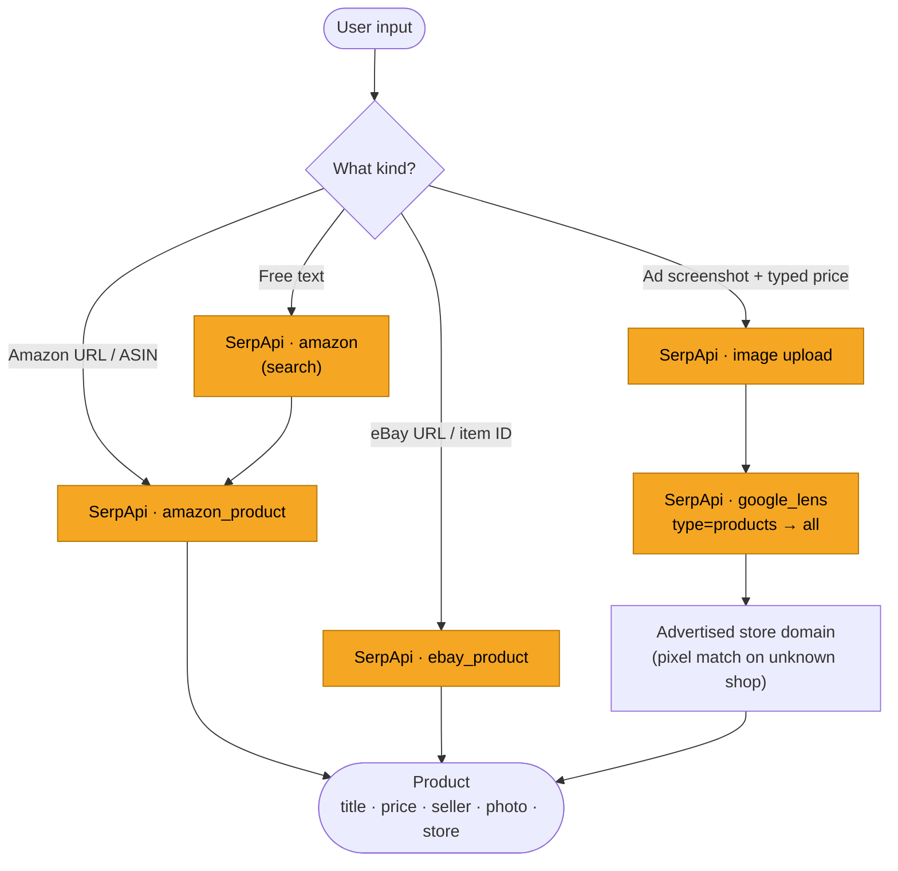
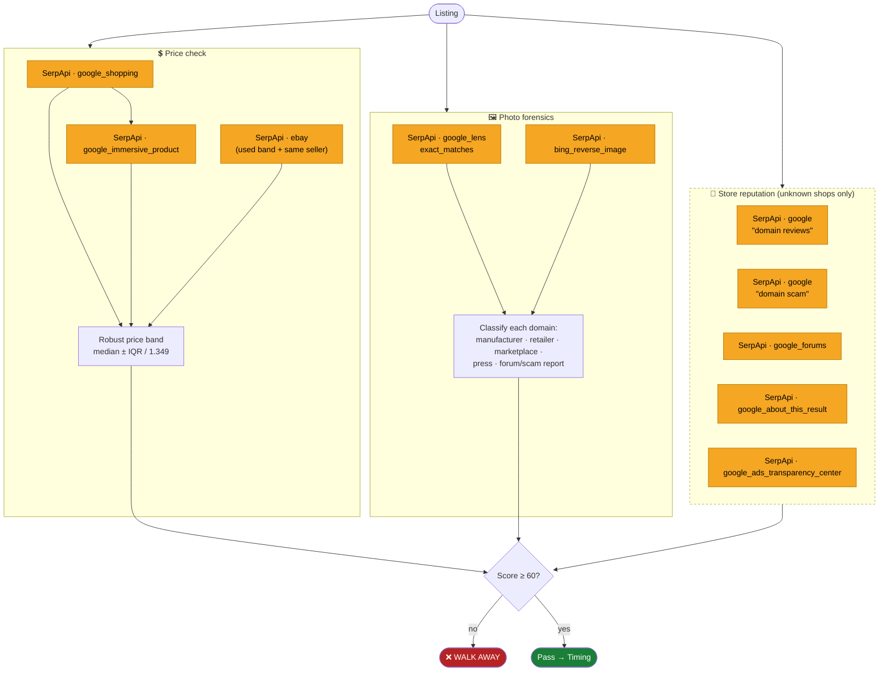
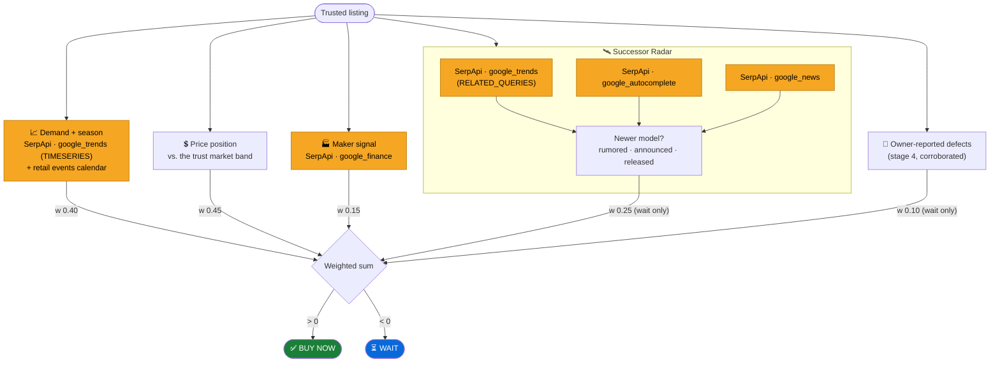
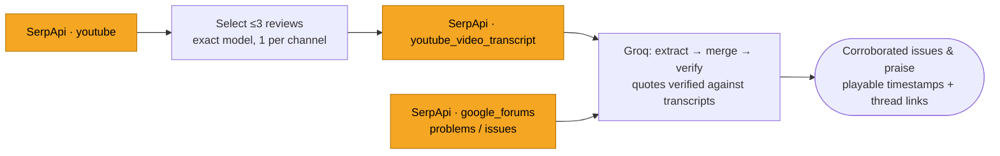
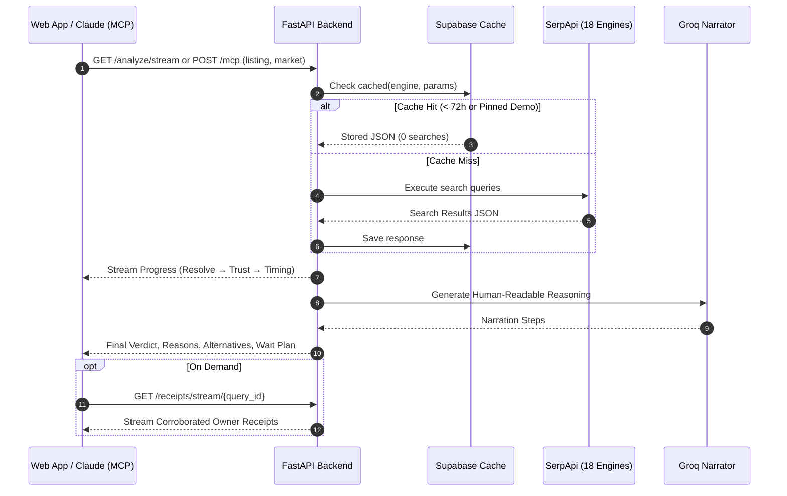

<div align="center">

<picture>
  <source media="(prefers-color-scheme: dark)" srcset="./asset/Clarity.png">
  <source media="(prefers-color-scheme: light)" srcset="./asset/Clarity.png">
  
</picture>

**Buy Now, Wait or Walk Away.**

[](./LICENSE)
[](https://serpapi.com)
[](https://www.python.org)
[](https://fastapi.tiangolo.com)
[](https://nextjs.org)
[](https://groq.com)
[](https://modelcontextprotocol.io)

</div>

Paste a product link, search query, or ad screenshot, and Clarity tells you whether to trust the listing, whether now is a good time to buy, and why. Every reason links back to live search evidence pulled through **[SerpApi](https://serpapi.com)** across **18 search engines**.

Clarity offers first-class multi-market support for **India** (amazon.in, Indian retailers like Flipkart and Croma, whole-rupee ₹ pricing, Big Billion Days and Diwali) and the **US** (amazon.com, eBay, $ pricing, Black Friday and Cyber Monday).

It is available both as a modern web application (an animated landing page at `/` and an interactive listing checker at `/check`) and as a native **Model Context Protocol (MCP)** server mounted at `/mcp`, allowing AI assistants like **Claude** to verify listings and render an interactive inline **Evidence Board** directly inside chat conversations.

---

## Table of contents

- [The idea in 30 seconds](#the-idea-in-30-seconds)
- [The engine at a glance](#the-engine-at-a-glance)
- [SerpApi at every stage](#serpapi-at-every-stage)
- [Stage by stage](#stage-by-stage)
  - [1. Resolve](#1-resolve-what-is-the-user-looking-at)
  - [2. Trust](#2-trust-is-the-listing-legit)
  - [3. Timing](#3-timing-buy-now-or-wait)
  - [4. What owners say](#4-what-owners-say-weight-010-wait-only)
  - [5. Narrator](#5-narrator)
  - [6. Where to buy instead](#6-where-to-buy-instead)
  - [7. What to wait for](#7-what-to-wait-for)
  - [8. Visual Evidence & Decision Charts](#8-visual-evidence--decision-charts)
- [Model Context Protocol (MCP) & Claude](#model-context-protocol-mcp--claude)
- [Markets: India and the US](#markets-india-and-the-us)
- [Web application experience](#web-application-experience)
- [Full request lifecycle](#full-request-lifecycle)
- [Caching and search budget](#caching-and-search-budget)
- [Project layout](#project-layout)
- [Running locally](#running-locally)
- [API](#api)
- [License](#license)

---

## The idea in 30 seconds

You found a deal. Clarity answers two questions in strict order:

**1. Can I trust this listing?** Is the price believable compared to the broader market, is the photo stolen or a studio render on a "used" item, and is the seller/store legitimate? If not, the answer is **Walk Away** and Clarity stops immediately.

**2. Is now the right time?** Is search interest rising or cooling, is the price favorable compared to other retailers, is a major sale event around the corner, and is a newer successor model about to launch? The answer is **Buy Now** or **Wait**.

Next to the verdict, Clarity surfaces **What owners say**: corroborated defects and praise extracted from independent YouTube video transcripts and forum threads, timestamped and linked. Only issues corroborated by multiple independent sources count as a small signal that can nudge toward **Wait**, but never toward Buy Now.

When the answer is **Walk Away**, or **Wait** because an established retailer is cheaper, Clarity tells you **where to buy instead**: a major retailer selling the identical product within the normal market price band, complete with a direct link. A **Wait** verdict also carries **what to wait for**: a concrete target price and the exact calendar, successor, or seasonal window to check again.

Every check is a deterministic, readable code rule with no opaque scoring. An LLM (Groq) is used strictly to synthesize the code-computed facts into concise, plain-English explanations.

---

## The engine at a glance


> [!IMPORTANT]
> **Trust gates timing.** A listing that fails the trust check never advances to the timing pipeline. A fraudulent or suspicious listing will never be recommended as "Buy Now, demand is rising".

---

## SerpApi at every stage

Clarity orchestrates **18 SerpApi engines**. Every request routes through a single cached client (`backend/serpapi.py`).

| Stage | SerpApi engine | What Clarity uses it for |
|---|---|---|
| **1. Resolve input** | `amazon_product` | Listing details from an Amazon ASIN (`amazon.com` or `amazon.in`) |
| | `ebay_product` | eBay listing details, seller history, and return policies |
| | `amazon` (Amazon Search) | Resolves typed product queries to the top catalog listing |
| | `google_lens` (`products`, then `all`) | Identifies the product from an uploaded ad screenshot |
| **2a. Trust: price** | `google_shopping` | Multi-store new retail pricing across the market |
| | `google_immersive_product` | Full store price directory for the reference product |
| | `ebay` (eBay Search) | Secondhand price band and seller-pattern listings |
| **2b. Trust: photo forensics** | `google_lens` (`exact_matches`) | Online presence of the listing's photos across the web |
| | `bing_reverse_image` | Secondary reverse-image verification ("pages with this image") |
| **2c. Trust: store reputation** | `google` (Google Search) ×2 | `"<domain> reviews"` and `"<domain> scam"` |
| | `google_forums` | Community forum discussions about the store |
| | `google_about_this_result` | Google knowledge graph entry for unknown store domains |
| | `google_ads_transparency_center` | Verifies whether the merchant runs authenticated ads |
| **3a. Timing: demand & season** | `google_trends` (`TIMESERIES`, 5 years) | Longitudinal search interest and seasonal demand patterns |
| **3b. Timing: maker signal** | `google_finance` | Brand's parent company stock momentum over 6 months |
| **3c. Timing: Successor Radar** | `google_trends` (`RELATED_QUERIES`) | Rising search queries naming a successor model |
| | `google_autocomplete` | Suggestion queries predicting newer iterations |
| | `google_news` | Dated headlines on rumored, announced, or released successors |
| **4. What owners say** | `youtube` (YouTube Search) | Independent review videos for the exact model |
| | `youtube_video_transcript` | Timestamped transcripts of review videos |
| | `google_forums` | Owner threads discussing `"<product> problems"` and `"<product> issues"` |

> [!NOTE]
> Screenshot uploads leverage SerpApi's **image upload endpoint** (`serpapi.com/image`) to obtain an `image_id` for Google Lens processing.

---

## Stage by stage

### 1. Resolve: what is the user looking at?



> [!NOTE]
> Clarity never guesses or OCRs prices from screenshots; the ad price is explicitly supplied by the user to avoid extraction errors. If Google Lens cannot identify the product with high confidence, Clarity halts rather than guessing.

### 2. Trust: is the listing legit?

Three parallel evidence checks evaluate the listing. Each failed check subtracts its weight from an initial score of 100. Any score below 60 triggers **Walk Away**.



Additional trust dimensions evaluated: rating and review volume, seller sales history, return policies, and historical price movements from prior Clarity checks.

> [!TIP]
> If a search engine times out or is unreachable, the check is marked **unavailable** with zero penalty points. A missing external source never causes a listing to fail.

### 3. Timing: buy now or wait?

Each signal produces a score from −1 (wait) to +1 (buy now). Clarity computes their weighted sum; the magnitude determines the verdict confidence.



| Signal | Source | Weight | Direction |
|---|---|---:|---|
| **Demand + season** | `google_trends` (TIMESERIES) + retail calendar | 0.40 | Bidirectional |
| **Price position** | Trust market band (median and dispersion) | 0.45 | Bidirectional |
| **Maker signal** | `google_finance` (6-month parent stock) | 0.15 | Bidirectional |
| **Successor Radar** | `google_trends`, `google_autocomplete`, `google_news` | 0.25 | Wait only |
| **Owner-reported defects** | Stage 4 corroborated defects (−1.0 confirmed, −0.5 concern) | 0.10 | Wait only |

### 4. What owners say (weight 0.10, wait only)

Runs asynchronously once trust passes. The timing engine checks cached receipts (waiting at most 8 s); the full receipt evidence streams to the client as it finishes.



- An issue counts as **known** only when corroborated by two or more independent sources.
- Every transcript quote is verified in code against the source transcript.
- Praise, isolated complaints, and missing owner data score 0; an unreviewed product is never penalized.
- Tests prove strict bounds (`test_receipts_weight.py`): it can only nudge toward wait, can flip a verdict only when confidence is 55% or lower, and cannot overcome a strongly favorable price.

### 5. Narrator

Groq (`openai/gpt-oss-120b`) transforms the structured trust and timing signals into the reasoning chain shown to the user. The LLM makes **zero SerpApi calls** and **never determines the verdict**—all conclusions are established in code.

### 6. Where to buy instead

On **Walk Away**, and on **Wait** when an established store is cheaper than the listing, Clarity identifies the lowest-priced store from the reference product's store directory (`google_immersive_product`) that:

- Is a verified major retailer (e.g., Best Buy, Walmart, Target, Flipkart, Croma, Reliance Digital), never an unknown third-party seller on a marketplace platform.
- Sells within the normal market band (median ± 2σ), ensuring it is an authentic market price and not a suspicious low-price listing.
- Is not the retailer where the listing is currently hosted.

This requires **zero extra searches**, never alters the verdict, and operates independently of the LLM. Used and refurbished listings compare against secondhand marketplaces and do not suggest retail alternatives.

### 7. What to wait for

A **Wait** verdict includes an actionable plan (`timing.wait_plan`), synthesized deterministically in code:

- **Target price:** The lowest verified price from a trusted major retailer today when cheaper than the listing. Otherwise, a standard good market price (median − 1σ), strictly floored above the anomalous price threshold (median − 2σ).
- **When to check again:** Derived from the earliest applicable event: an announced successor release date, an upcoming major retail sale (within 12 weeks), or a seasonal cooling pattern in search interest over the subsequent 8 weeks.

Clarity never fabricates speculative price forecasts; SerpApi provides present search and pricing data, so Clarity indicates *when to re-check*, not an ungrounded price prediction.

### 8. Visual Evidence & Decision Charts

Rather than relying on blocks of text, Clarity communicates decision factors visually across dedicated charts (`frontend/src/components/decision-charts.tsx`):

- **Verdict Gauge:** A high-contrast needle gauge displaying the decision, confidence percentage, idle ticks, and decision boundary thresholds.
- **Visual Trust Checks Grid:** Status cards highlighting price deviation, photo forensics matches, seller history, and domain verification.
- **Price vs. Market Band Dot Histogram:** Plots the current listing price against the retail or secondhand median, showing quartile spread and the ±2σ bounds.
- **Timing Drivers Breakdown:** Interactive component bars illustrating each timing signal's contribution alongside a "what would flip it" sensitivity analysis.
- **Search Interest Dot Matrix & KPIs:** A 52-week search interest pattern from Google Trends with 4-week vs. 8-week momentum metrics.
- **Diverging Owner Sentiment Bars:** A visual balance chart of corroborated defects vs. praise, sized by independent source count, paired with clickable, timestamped YouTube review quotes.

---

## Model Context Protocol (MCP) & Claude

Clarity ships with a built-in **Model Context Protocol (MCP)** server mounted at `/mcp` using Streamable HTTP (stateless, zero session tracking required). Any MCP-compatible client—including Claude Desktop, Claude Web, and Claude Code—can connect directly.

```
Claude Desktop / Claude Code
           │
           │  Streamable HTTP POST /mcp
           ▼
    FastAPI (/mcp)
           │
  clarity_check_listing (URL or query)
           │
  ├── Trust Check (Google Shopping, Lens, Bing, Store Rep)
  ├── Timing Check (Trends, Finance, News, Autocomplete)
  └── Returns: Structured Verdict, Reasons, Alternatives, Wait Plan
           │
           ▼
  Interactive Evidence Board View (ui://clarity/evidence-board.html)
```

### The `clarity_check_listing` Tool

Exposed to language models with full tool annotations:

```python
clarity_check_listing(
    listing: str,           # Amazon or eBay URL, or product name
    market: "in" | "us"     # Target market (defaults to "in" for text queries; URLs auto-detect)
)
```

**Verdicts returned:**
- `walk_away`: Failed trust check (anomalous price, stolen photos, unverified seller). Timing is skipped.
- `buy_now`: Passed trust check; timing signals favor buying now.
- `wait`: Passed trust check; timing signals favor waiting for a better price, sale event, or successor model.
- `buy_timing_not_judged`: Passed trust check; insufficient market volume to judge timing.
- `could_not_check`: Analysis incomplete or invalid input (treated as unverified, not safe).

### Interactive MCP App View

Hosts supporting **MCP Apps** automatically render Clarity's interactive Evidence Board (`ui://clarity/evidence-board.html`) inline in the conversation window. The view provides:
- High-resolution listing photos and verified reverse-image matches.
- Visual trust status indicators and price distribution bars.
- Corroborated owner quotes with playable YouTube video excerpts starting at the exact timestamp.
- Successor radar status cards.

### Adding Clarity to Claude

**Claude Desktop or Claude Web:**
1. Open **Settings → Connectors → Add custom connector**.
2. Set Connector URL to `http://localhost:8000/mcp`.

**Claude Code CLI:**
```bash
claude mcp add --transport http clarity http://localhost:8000/mcp
```

---

## Markets: India and the US

Clarity evaluates every listing in its authentic native market: Indian retailers and ₹ for India; US retailers and $ for the United States. **The URL determines the market automatically**: an `amazon.in` link runs against India, while `amazon.com` or `ebay.com` links run against the US. For free-text queries and screenshot uploads, the user selects the market (the web app defaults to **India**).

| Dimension | India (`in`) | United States (`us`) |
|---|---|---|
| **Listing Engine** | `amazon_product` (`amazon_domain=amazon.in`) | `amazon_product` (`amazon.com`), `ebay_product` |
| **Market Prices** | `google_shopping` (`gl=in`), formatted in ₹ | `google_shopping` (`gl=us`), formatted in $ |
| **Currency Formatter** | Whole rupees with Indian digit grouping (`₹1,24,990`) | Standard dollar formatting (`$329.20`) |
| **Retailer References** | Amazon.in, Flipkart, Croma, Reliance Digital, Vijay Sales, Tata CLiQ, JioMart, Myntra, Ajio | Best Buy, Walmart, Target, Home Depot, Costco, B&H Photo, Sam's Club |
| **Market Filtering** | Filters out converted paise (foreign shops) and cross-border import shops (Ubuy, Desertcart) | Filters out peer-to-peer marketplaces (Mercari, Poshmark, OfferUp) |
| **Secondhand Band** | Skipped (eBay India ceased operations in 2017); never a score penalty | eBay sold and active listings in matching condition |
| **Demand & Successors** | `google_trends` (`geo=IN`), `google_news` (`gl=in`) | `google_trends` (worldwide), `google_news` (`gl=us`) |
| **Sale Calendar** | Great Indian Festival, Big Billion Days, Diwali, Prime Day India, Great Republic Day Sale, Great Freedom Festival | Prime Day, Prime Big Deal Days, Black Friday, Cyber Monday, Diwali (audio/gaming) |
| **1st-Party Seller Waiver** | Amazon itself only; affiliated sellers (Clicktech, Appario) undergo standard price checks | Amazon.com |

Global signals such as YouTube owner reviews and manufacturer forums remain global across all markets. Market configurations are centralized in `backend/locales.py`.

---

## Web application experience

Clarity features a high-performance frontend built on Next.js 16, React 19, and Tailwind CSS 4:

- **Landing Page (`/`):** Features an animated hero pipeline flow (`frontend/src/components/hero-flow.tsx`) visualizing the transition from raw inputs to SerpApi extraction, trust gating, timing analysis, and final decision verdicts.
- **Listing Checker (`/check`):** The primary interactive diagnostic interface with multi-input tabs (product URL, product search name, ad screenshot upload with manual price entry), India / US market switchers, pre-verified demo chips, and live SSE progress streaming.
- **Site Navigation & Claude Drawer:** A persistent floating pill navigation bar (`site-nav.tsx`) paired with an "About / Add to Claude" modal drawer (`about-sheet.tsx`) providing one-click copying of MCP connection endpoints.

---

## Full request lifecycle



---

## Caching and search budget

| Feature | Implementation |
|---|---|
| **Response Cache** | Every SerpApi response is indexed in the Supabase table `serpapi_cache` using `sha256(engine + params)`. |
| **Cache TTL** | Identical queries cost **0 live searches** for 72 hours (`SERPAPI_CACHE_TTL_HOURS`). |
| **Pinned Fixtures** | Demo products and synthetic screenshots are permanently pinned in `demo_fixtures.py`, guaranteeing deterministic replays without consuming live search quota. |
| **LLM Caching** | Groq owner-receipt summarizations and narration chains are cached in the same database. |

---

## Project layout

```
Clarity/
├── backend/                       FastAPI + rule-based pipeline (Python ≥3.12, uv)
│   ├── main.py                    FastAPI app, SSE routes, mounts /mcp
│   ├── clarity_mcp/               Model Context Protocol (MCP) server
│   │   ├── server.py              Streamable HTTP MCP server (clarity_check_listing)
│   │   ├── contract.py            Structured output schema & text formatting
│   │   ├── runner.py              Synchronous pipeline bridge for MCP tools
│   │   ├── view/                  Interactive Evidence Board view (Vite + React)
│   │   └── tests/                 Contract schema & pipeline parity tests
│   ├── orchestrator.py            Trust gating, timing pipeline & SSE streaming
│   ├── resolve.py                 Resolves URL / query / screenshot to product
│   ├── serpapi.py                 Unified SerpApi client with Supabase cache
│   ├── trust.py                   Price band anomaly, seller, and listing checks
│   ├── alternatives.py            Identifies reputable alternative retailers
│   ├── locales.py                 Market logic: India & US (retailers, ₹/$, parameters)
│   ├── photo_forensics.py         Google Lens + Bing reverse image verification
│   ├── store_reputation.py        Domain reputation checks for unknown shops
│   ├── timing.py                  Demand trend, price position, maker stock & wait plan
│   ├── lifecycle.py               Successor Radar rules (Trends, News, Autocomplete)
│   ├── events.py                  Retail sale calendar (India & US)
│   ├── receipts.py                Owner review extraction (YouTube transcripts + forums)
│   ├── narrator.py                Groq LLM explanation generation
│   ├── domains.py                 Domain categorization (maker, retailer, peer)
│   ├── demo_products.py           Pre-verified demo catalogue & test fixtures
│   ├── demo_fixtures.py           Fixture pinning logic
│   ├── schema.sql                 Supabase database schema
│   └── test_*.py                  Unit, replay, weight, and market regression tests
├── frontend/                      Next.js 16 + React 19 + Tailwind 4 + shadcn/ui
│   ├── src/app/
│   │   ├── page.tsx               Landing page with animated hero flow
│   │   ├── check/page.tsx         Interactive listing checker with SSE streaming
│   │   └── globals.css            Design tokens, theme variables & viz palette
│   └── src/components/
│       ├── hero-flow.tsx          Animated input-to-verdict pipeline visualization
│       ├── decision-charts.tsx    Verdict gauge, trust matrix, price histogram, timing breakdown
│       ├── about-sheet.tsx        About drawer with Claude connection instructions
│       ├── site-nav.tsx           Floating pill navigation
│       ├── evidence-board.tsx     Listing details, seller reputation, photo forensics
│       ├── owner-receipts.tsx     Diverging sentiment bar chart & timestamped video quotes
│       └── successor-radar.tsx    Successor model detection and release timeline
└── phase0/                        Empirical probes evaluating SerpApi engines
    ├── india_probe/               India market probe (amazon.in, Shopping, Trends, NSE)
    └── photo_probe/               Photo forensics & synthetic screenshot probe
```

---

## Running locally

### 1. Database

Execute `backend/schema.sql` inside the Supabase SQL editor to create the cache tables.

### 2. Backend

Create `backend/.env`:

```env
SERPAPI_KEY=your_serpapi_key
GROQ_API_KEY=your_groq_api_key
SUPABASE_URL=your_supabase_project_url
SUPABASE_SECRET_KEY=your_supabase_service_role_key

# Optional settings
SERPAPI_CACHE_TTL_HOURS=72
CORS_ORIGINS=http://localhost:3000
```

Start the server:

```bash
cd backend
uv sync
uv run uvicorn main:app --reload --port 8000
```

The API will be available at `http://localhost:8000`, and the MCP server will respond at `http://localhost:8000/mcp`.

### 3. Frontend

Create `frontend/.env.local`:

```env
NEXT_PUBLIC_API_URL=http://localhost:8000
```

Start the development server:

```bash
cd frontend
npm install
npm run dev
```

Visit `http://localhost:3000` for the landing page or `http://localhost:3000/check` for the listing checker.

### 4. Tests

Tests run against pinned demo fixtures without making live SerpApi calls or spending search budget:

```bash
cd backend
uv run python test_gate.py
uv run python test_demo_replay.py
uv run python test_receipts_weight.py
uv run python test_lifecycle_weights.py
uv run python test_non_demo.py
uv run python test_alternatives.py
uv run python test_wait_plan.py
uv run python test_india.py
PYTHONPATH=. uv run python clarity_mcp/tests/test_contract.py
```

---

## API

| Method | Route | Description |
|---|---|---|
| `GET` | `/health` | Health check endpoint |
| `GET` | `/demo-products` | Retrieves demo chips for the user interface |
| `POST` | `/analyze` | Synchronous analysis returning full JSON payload (`q`: link or query, `market`: `"in"` or `"us"`) |
| `GET` | `/analyze/stream` | Server-Sent Events (SSE) stream reporting step-by-step pipeline progress |
| `POST` | `/analyze/image` | Ad screenshot upload endpoint (accepts `file`, `price`, `market`; returns `job_id`) |
| `GET` | `/analyze/image/stream/{job_id}` | Streams analysis progress for an uploaded ad screenshot |
| `GET` | `/receipts/stream/{query_id}` | Streams owner receipts and video transcripts on demand |
| `POST`/`GET` | `/mcp` | Streamable HTTP Model Context Protocol (MCP) server for Claude and AI clients |

---

## License

[MIT](./LICENSE) © Yash Agarwal
