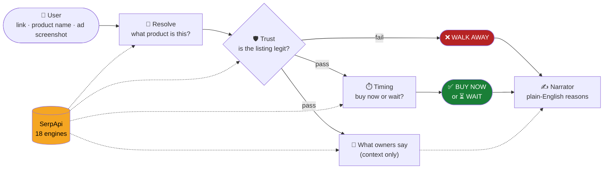
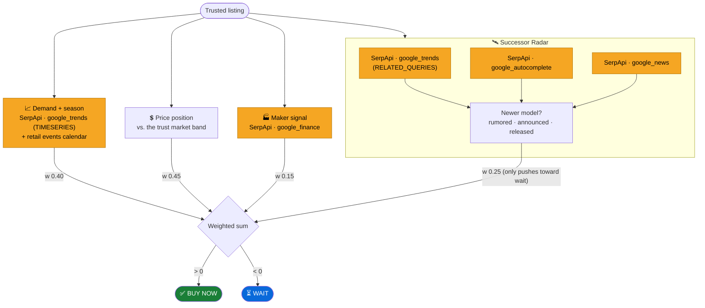
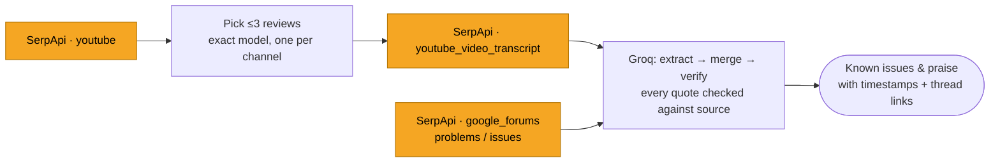
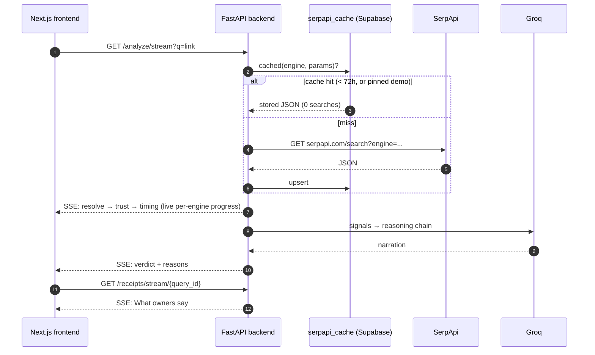

<div align="center">

<picture>
  <source media="(prefers-color-scheme: dark)" srcset="./asset/Clarity.png">
  <source media="(prefers-color-scheme: light)" srcset="./asset/Clarity.png">
  
</picture>

**Buy Now, Wait or Walk Away.**

[](./LICENSE)
[](https://serpapi.com)
[](https://www.python.org)
[](https://fastapi.tiangolo.com)
[](https://nextjs.org)
[](https://groq.com)

</div>

Paste a product link and Clarity tells you whether to trust the listing, whether now is a
good time to buy, and why. Every reason links back to live search evidence pulled through
**[SerpApi](https://serpapi.com)**.

---

## Table of contents

- [The idea in 30 seconds](#the-idea-in-30-seconds)
- [The engine at a glance](#the-engine-at-a-glance)
- [SerpApi at every stage](#serpapi-at-every-stage)
- [Stage by stage](#stage-by-stage)
  - [1. Resolve](#1-resolve-what-is-the-user-looking-at)
  - [2. Trust](#2-trust-is-the-listing-legit)
  - [3. Timing](#3-timing-buy-now-or-wait)
  - [4. What owners say](#4-what-owners-say-weight-0)
  - [5. Narrator](#5-narrator)
- [Full request lifecycle](#full-request-lifecycle)
- [Caching and search budget](#caching-and-search-budget)
- [Project layout](#project-layout)
- [Running locally](#running-locally)
- [API](#api)
- [License](#license)

---

## The idea in 30 seconds

You found a deal. Clarity answers two questions in order:

**1. Can I trust this listing?** Is the price believable, is the photo stolen from
somewhere else, and is the store real? If not, the answer is **Walk Away** and Clarity
stops there.

**2. Is now the right time?** Is demand rising or cooling, is the price good compared with
other stores, is a sale coming, and is a newer model about to launch? The answer is
**Buy Now** or **Wait**.

Next to the verdict, Clarity shows **What owners say**: problems and praise from
independent YouTube reviews and forum threads, each linked to a video timestamp or thread.
This section is context only and never changes the verdict.

Every check is a rule you can read in the code, with no black-box score. An LLM (Groq)
only turns the finished signals into plain English.

---

## The engine at a glance



> [!IMPORTANT]
> **Trust gates timing.** A listing that fails trust never gets a timing verdict, so a
> scam can't come back as "Buy Now, prices are rising".

---

## SerpApi at every stage

Clarity uses **18 SerpApi engines**. Each call goes through one cached client
(`backend/serpapi.py`).

| Stage | SerpApi engine | What Clarity uses it for |
|---|---|---|
| **1. Resolve input** | `amazon_product` | Amazon listing details from an ASIN |
| | `ebay_product` | eBay listing details from an item ID |
| | `amazon` (Amazon Search) | Free-text product name to the top Amazon result |
| | `google_lens` (`products`, then `all`) | Identifies the product in an uploaded ad screenshot |
| **2a. Trust: price** | `google_shopping` | New-condition retail prices across stores |
| | `google_immersive_product` | Full store price list for the reference product |
| | `ebay` (eBay Search) | Used-price band, plus the same seller's other listings |
| **2b. Trust: photo forensics** | `google_lens` (`exact_matches`) | Where else the listing photo appears online |
| | `bing_reverse_image` | Second reverse-image source ("pages with this image") |
| **2c. Trust: store reputation** | `google` (Google Search) ×2 | `"<domain> reviews"` and `"<domain> scam"` |
| | `google_forums` | Forum talk about the store |
| | `google_about_this_result` | What Google knows about the site |
| | `google_ads_transparency_center` | Whether the store runs verified ads |
| **3a. Timing: demand & season** | `google_trends` (`TIMESERIES`, 5 years) | Demand trend and seasonal price windows |
| **3b. Timing: maker signal** | `google_finance` | The brand's stock momentum over 6 months |
| **3c. Timing: Successor Radar** | `google_trends` (`RELATED_QUERIES`) | Rising searches that name a newer model |
| | `google_autocomplete` | Suggestions that name a newer model |
| | `google_news` | Rumored, announced or released successor |
| **4. What owners say** | `youtube` (YouTube Search) | Independent review videos for this exact model |
| | `youtube_video_transcript` | Timestamped transcripts of those videos |
| | `google_forums` | Owner threads about `"<product> problems"` and `"<product> issues"` |

> [!NOTE]
> Screenshot uploads also use SerpApi's **image upload endpoint** (`serpapi.com/image`) to
> get an `image_id` for Google Lens.

In every diagram below, **SerpApi calls are highlighted in amber**.

---

## Stage by stage

### 1. Resolve: what is the user looking at?

```mermaid
flowchart TD
    IN(["User input"]) --> Q{"What kind?"}
    Q -- "Amazon URL / ASIN" --> AP["SerpApi · amazon_product"]
    Q -- "eBay URL / item ID" --> EP["SerpApi · ebay_product"]
    Q -- "Free text" --> AS["SerpApi · amazon<br/>(search)"] --> AP
    Q -- "Ad screenshot + typed price" --> UP["SerpApi · image upload"] --> GL["SerpApi · google_lens<br/>type=products → all"]
    GL --> ST["Advertised store domain<br/>(pixel match on one unknown shop)"]
    AP & EP & ST --> P(["Product<br/>title · price · seller · photo · store"])

    classDef serp fill:#f5a623,stroke:#b37400,color:#000
    class AP,EP,AS,UP,GL serp
```



> [!NOTE]
> Clarity never reads a price out of a screenshot. The price comes only from what the user
> types. If Lens can't name the product with confidence, Clarity says so and stops instead
> of guessing.

### 2. Trust: is the listing legit?

Three evidence checks run in parallel. Each failed check subtracts its severity weight from
a score of 100, and a score below 60 means **Walk Away**.


Other trust checks: review count and rating, seller sales, and price history from earlier
Clarity checks of the same listing.

> [!TIP]
> If an engine times out, Clarity marks that check **unavailable** and gives it zero
> points. A missing check can't fail a listing.

### 3. Timing: buy now or wait?

Each signal scores from −1 (wait) to +1 (buy now). Clarity takes the weighted sum, and its
size sets the confidence.



| Signal | Source | Weight |
|---|---|---:|
| Demand + season | `google_trends` (TIMESERIES) + retail events calendar | 0.40 |
| Price position | Trust market band | 0.45 |
| Maker signal | `google_finance` | 0.15 |
| Successor Radar | `google_trends` (RELATED_QUERIES), `google_autocomplete`, `google_news` | 0.25, only pushes toward wait |

### 4. What owners say (weight 0)

This stage runs next to timing once trust passes, and it arrives after the verdict.



An issue counts as **known** only if two or more independent sources back it. Code checks
every quote against the transcript or thread it came from.

> [!IMPORTANT]
> Tests prove this stage never changes a score (`test_receipts_weight0.py`).

### 5. Narrator

Groq (`openai/gpt-oss-120b`) turns the structured trust and timing signals into the
reasoning chain the user reads. It makes **no SerpApi calls** and **never decides the
verdict**.

---

## Full request lifecycle



---

## Caching and search budget

| | |
|---|---|
| **Cache** | Every SerpApi response is stored in the Supabase table `serpapi_cache`, keyed by `sha256(engine + params)` |
| **TTL** | Repeat checks cost **0 searches** for 72 hours (`SERPAPI_CACHE_TTL_HOURS`) |
| **Demo pins** | Demo products are **pinned** (`demo_fixtures.py`), so the demo replays even after the real listings end |
| **LLM cache** | Groq results for owner receipts are cached in the same table, so a replay is fully offline |

---

## Project layout

```
Clarity/
├── backend/                 FastAPI + rule-based agents (Python ≥3.12, uv)
│   ├── main.py              HTTP + SSE endpoints
│   ├── orchestrator.py      Trust gates timing; streams every step
│   ├── resolve.py           URL / text / screenshot → product
│   ├── serpapi.py           The only SerpApi client, cached in Supabase
│   ├── trust.py             Price, listing and seller checks
│   ├── photo_forensics.py   Google Lens + Bing reverse image
│   ├── store_reputation.py  Five searches about an unknown shop
│   ├── timing.py            Demand, price, maker, lifecycle → buy/wait
│   ├── lifecycle.py         Successor Radar rules
│   ├── events.py            Retail sale calendar (US)
│   ├── receipts.py          What owners say (YouTube + forums)
│   ├── narrator.py          Groq write-up
│   ├── domains.py           Who owns a domain (maker, retailer, ...)
│   ├── demo_products.py     Pre-verified demo set
│   ├── demo_fixtures.py     Pins demo SerpApi responses
│   ├── schema.sql           Supabase tables
│   └── test_*.py            Gate, replay, weight and regression tests
├── frontend/                Next.js 16 + React 19 + Tailwind 4 + shadcn/ui
│   └── src/components/      Evidence board, owner receipts, successor radar
└── phase0/                  Probes that chose each SerpApi engine, with saved raw output
```

---

## Running locally

**1. Database.** Paste `backend/schema.sql` into the Supabase SQL editor and run it.

**2. Backend.** Create `backend/.env`:

```env
SERPAPI_KEY=...
GROQ_API_KEY=...
SUPABASE_URL=...
SUPABASE_SECRET_KEY=...
# optional
SERPAPI_CACHE_TTL_HOURS=72
CORS_ORIGINS=http://localhost:3000
```

```bash
cd backend
uv sync
uv run uvicorn main:app --reload --port 8000
```

**3. Frontend.** Create `frontend/.env.local` with `NEXT_PUBLIC_API_URL=http://localhost:8000`, then:

```bash
cd frontend
npm install
npm run dev
```

**4. Tests.** These run on pinned demo data, with no live searches:

```bash
cd backend
uv run python test_gate.py
uv run python test_demo_replay.py
uv run python test_receipts_weight0.py
uv run python test_lifecycle_weights.py
uv run python test_non_demo.py
```

### Configuration

| Variable | Default | Meaning |
|---|---|---|
| `SERPAPI_KEY` | | SerpApi key for every search engine |
| `GROQ_API_KEY` | | Narrator and owner-receipts LLM |
| `SUPABASE_URL`, `SUPABASE_SECRET_KEY` | | Cache and results database |
| `SERPAPI_CACHE_TTL_HOURS` | `72` | How long a cached SerpApi response is reused |
| `CORS_ORIGINS` | | Allowed frontend origins |
| `NEXT_PUBLIC_API_URL` | | Backend URL, read by the frontend |

---

## API

| Method | Route | Purpose |
|---|---|---|
| `GET` | `/health` | Liveness check |
| `GET` | `/demo-products` | Demo chips for the UI |
| `POST` | `/analyze` | Full analysis, one JSON response |
| `GET` | `/analyze/stream` | Same analysis as live SSE steps |
| `POST` | `/analyze/image` | Upload an ad screenshot (+ typed price) |
| `GET` | `/analyze/image/stream/{job_id}` | Stream the screenshot analysis |
| `GET` | `/receipts/stream/{query_id}` | Stream "What owners say" on request |

---

## License

[MIT](./LICENSE) © Yash Agarwal
