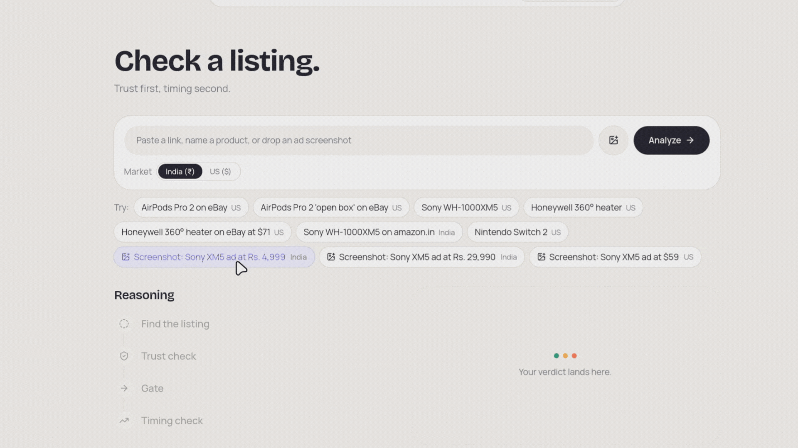
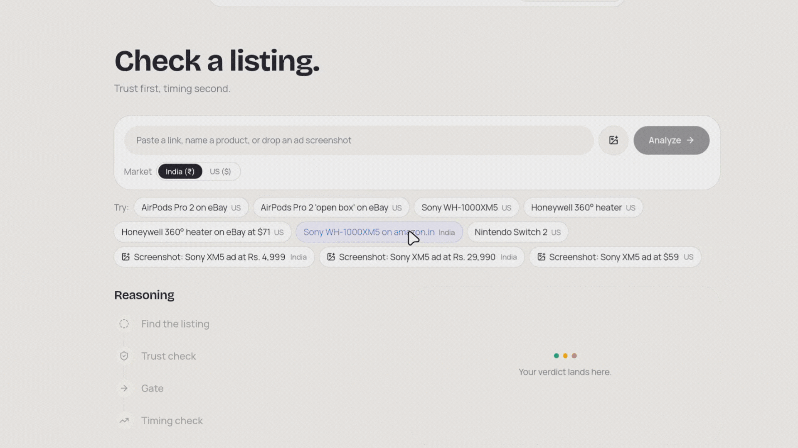
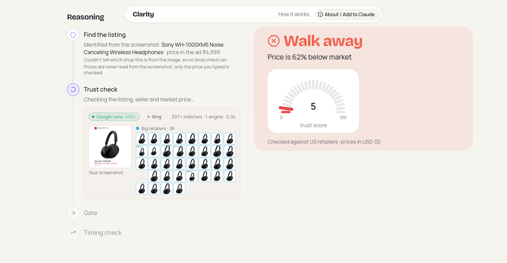
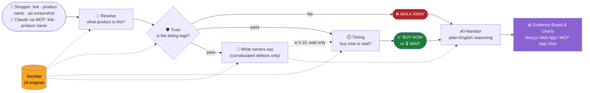
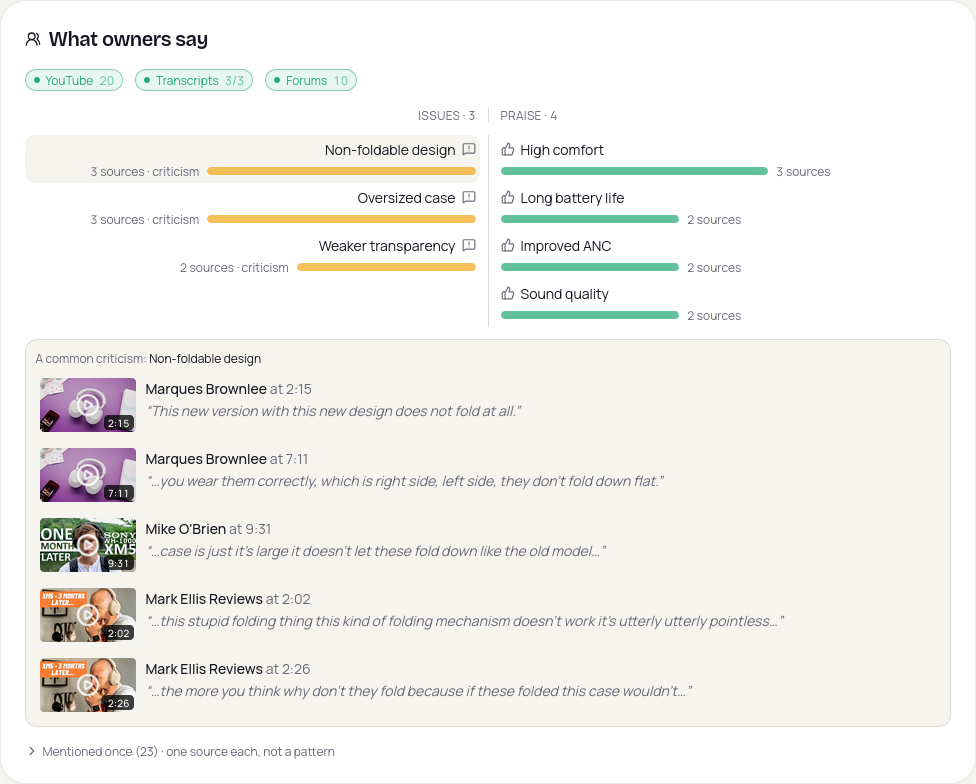
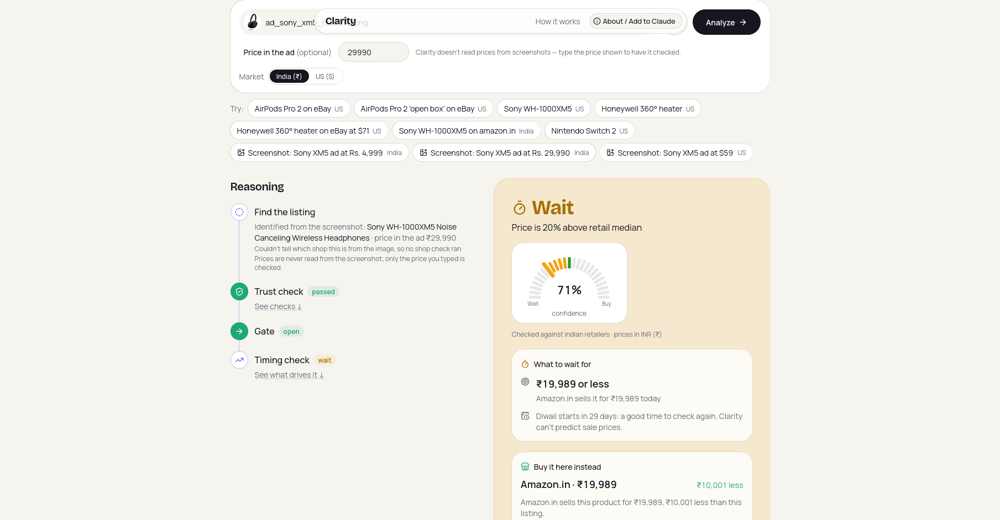
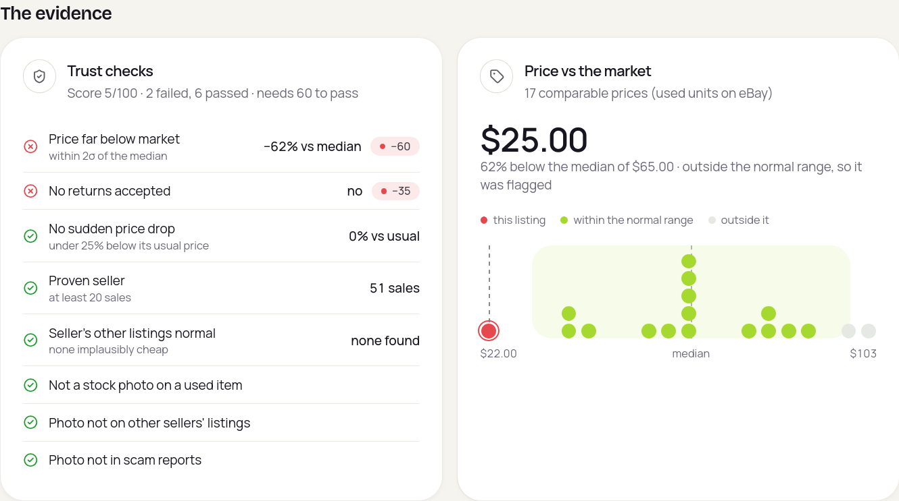
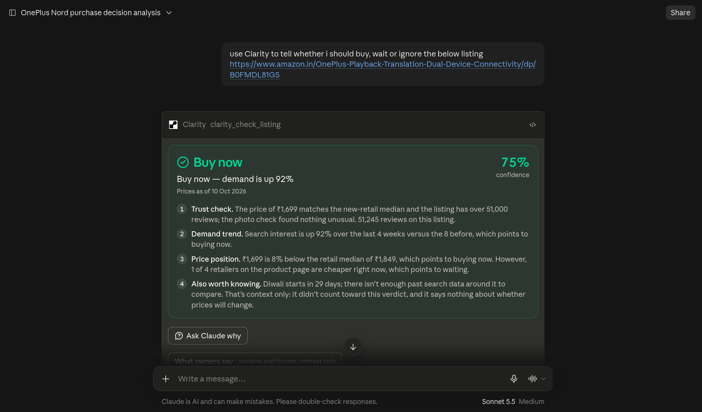
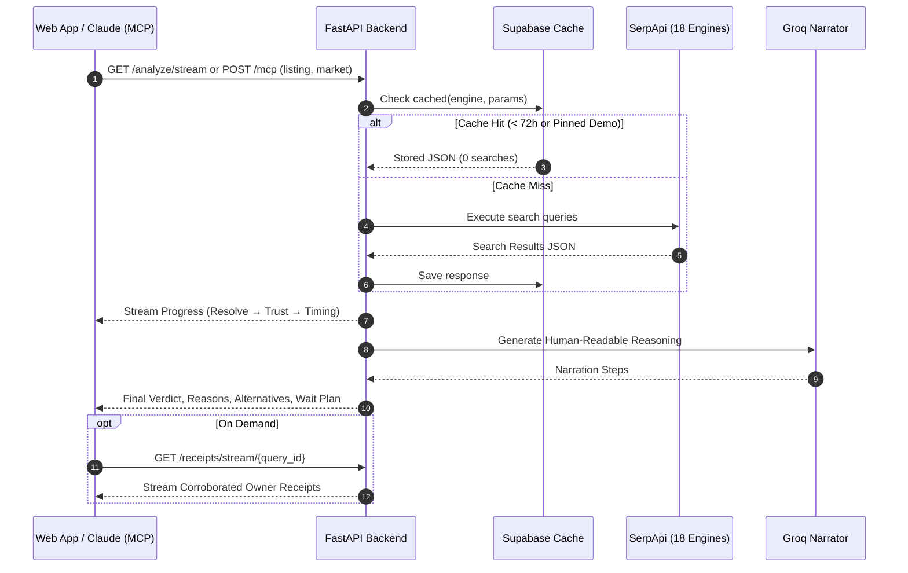

<div align="center">

<picture>
  <source media="(prefers-color-scheme: dark)" srcset="./asset/Clarity.png">
  <source media="(prefers-color-scheme: light)" srcset="./asset/Clarity.png">
  
</picture>

**Buy Now, Wait or Walk Away.**

Track: Commerce & Market Intelligence | [Live demo](https://clarity-serp-api.vercel.app/check) | [Demo video]() | [MCP endpoint (for Claude connectors)](https://clarity-backend-0hj7.onrender.com/mcp) | [Backend status](https://clarity-backend-0hj7.onrender.com/health)

[](./LICENSE)
[](https://serpapi.com)
[](https://www.python.org)
[](https://fastapi.tiangolo.com)
[](https://nextjs.org)
[](https://groq.com)
[](https://modelcontextprotocol.io)

 

</div>

Scam ads and too-good-to-be-true listings work because they pair a fake deal with urgency. That means a "price is crashing, buy now" tool is most dangerous exactly where it is most persuasive. Clarity refuses to discuss timing until the listing has earned trust: **trust gates timing, so a scam can never be told "demand is rising, buy now."**

Built for shoppers who encounter suspicious discount ads—such as an Indian consumer seeing an Instagram or WhatsApp ad for high-end headphones at 75% off from an unknown storefront—Clarity puts the ad screenshot flow front and center. You upload the screenshot, type the advertised price, and Clarity runs forensic reverse-image searches, market price band comparisons, and domain checks before it even considers whether today is a good time to buy.

<p align="center">
  
  <br><sub><em>Upload an ad screenshot and type the advertised price. Clarity identifies the product, checks the photo and store, and stops at Walk Away.</em></sub>
</p>

Online shopping scams are the most common scam type worldwide. GASA's Global State of Scams 2025 (46,000 adults, 42 markets) found that 57% of adults were scammed in the past year, 23% lost money, and shopping scams were the most commonly reported type at 54%. Its India survey of 1,000 adults found almost four in five had encountered a scam, roughly one every three days. Sources: [GASA Global State of Scams 2025](https://www.gasa.org/research) · [GASA State of Scams in India 2025](https://gasa.org/knowledge-base/reports/state-of-scams-in-india-2025)

---

## Table of contents

- [Why this is different](#why-this-is-different)
- [The idea in 30 seconds](#the-idea-in-30-seconds)
- [The engine at a glance](#the-engine-at-a-glance)
- [SerpApi at every stage: provably load-bearing](#serpapi-at-every-stage-provably-load-bearing)
- [Results](#results)
- [Document the numbers](#document-the-numbers)
- [Engineering challenges we hit](#engineering-challenges-we-hit)
- [Limitations and honest scope](#limitations-and-honest-scope)
- [Model Context Protocol (MCP) & Claude](#model-context-protocol-mcp--claude)
- [Deep dives & architectural detail](#deep-dives--architectural-detail)
- [Deployed setup](#deployed-setup)
- [Running locally](#running-locally)
- [API](#api)
- [Roadmap](#roadmap)
- [License](#license)

---

## Why this is different

| Approach | Question it answers | What it misses | Clarity |
|---|---|---|---|
| **Price-comparison tools**<br>*(Google Shopping, PriceGrabber)* | *"Where is this product cheapest right now?"* | Misses whether the cheapest store is a fly-by-night scam shop, whether the photo is stolen, and whether an upcoming successor or sale makes today a terrible time to buy. | Gated trust check verifies store authenticity, seller history, and photo forensics before comparing prices across verified major retailers. |
| **Price-history trackers**<br>*(Keepa, CamelCamelCamel)* | *"Is this price lower than it was last month on Amazon?"* | Misses cross-retailer competition, seller hijack scams, fake list prices ("50% off" an inflated baseline), and whether the product is obsolete. Requires historical tracking to already exist for that specific URL. | Evaluates live cross-market pricing, longitudinal Google Trends search interest, maker stock momentum, and successor rumors—working on any live listing or ad screenshot on day one. |
| **Review & scam checkers**<br>*(Trustpilot, ScamAdviser)* | *"Are these reviews fake or is this shop sketchy?"* | Misses market context and timing: a 100% legitimate listing from a verified seller can still be a terrible purchase if overpriced by 83% or launching a replacement model in three weeks. | Answers trust first; if trusted, performs multi-factor timing analysis to advise whether to buy today or wait for a specific price or event. |
| **Single-engine search wrappers**<br>*(Shopping, SEO, search demos)* | *"What does search engine X return for keyword Y?"* | Typically stop at returning results: no conditional decision logic, domain forensics, cross-engine correlation, or safety gating. | Chains 18 SerpApi engines across 4 stages into a conditional decision pipeline with graceful degradation; the LLM only narrates and never decides the verdict. |

The core novelty is the **conditional single verdict where trust gates timing, with the branch visible live**.

### Why rule-based and explainable is a deliberate choice

In consumer protection and shopping intelligence, no labeled, unbiased ground-truth dataset exists to train an end-to-end black-box classifier without severe hallucination risk. A machine learning model predicting "safe to buy" from text cannot be audited when a consumer loses money to a fraudulent store.

Every trust penalty, price dispersion band, and timing weight in Clarity is **auditable code with explicit mathematical boundaries**. The LLM (Groq) is used strictly as a narrator to translate verified, code-calculated facts into concise, plain English. The LLM never computes a score, never accesses search engines directly, and **never decides the verdict**.

---

## The idea in 30 seconds

You found a deal. Clarity answers two questions in strict order:

**1. Can I trust this listing?** Is the price believable compared to the broader market, is the photo stolen or a studio render on a "used" item, and is the seller/store legitimate? If not, the answer is **Walk Away** and Clarity stops immediately.

**2. Is now the right time?** Is search interest rising or cooling, is the price favorable compared to other retailers, is a major sale event around the corner, and is a newer successor model about to launch? The answer is **Buy Now** or **Wait**.

Next to the verdict, Clarity surfaces **What owners say**: corroborated defects and praise extracted from independent YouTube video transcripts and forum threads, timestamped and linked. Only issues corroborated by multiple independent sources count as a small signal that can nudge toward **Wait**, but never toward Buy Now.

When the answer is **Walk Away**, or **Wait** because an established retailer is cheaper, Clarity tells you **where to buy instead**: a major retailer selling the identical product within the normal market price band, complete with a direct link. A **Wait** verdict also carries **what to wait for**: a concrete target price and the exact calendar, successor, or seasonal window to check again.

---

## The engine at a glance



> [!IMPORTANT]
> **Trust gates timing.** A listing that fails the trust check never advances to the timing pipeline. A fraudulent or suspicious listing will never be recommended as "Buy Now, demand is rising".

---

## SerpApi at every stage: provably load-bearing

Clarity orchestrates **18 SerpApi engines**. Every request routes through a single cached client (`backend/serpapi.py`).

| Stage | SerpApi engine | Role | What Clarity uses it for | Decision it changes | Demo case where it is decisive |
|---|---|---|---|---|---|
| **1. Resolve input** | `amazon_product` | **Core** | Listing details from an Amazon ASIN | Extracts title, seller, price, and condition | `sony-xm5`, `honeywell-heater`, `sony-xm5-in`, `switch2` |
| | `ebay_product` | **Core** | Listing details from an eBay item ID | Extracts seller history, return policy, price | `airpods-ebay`, `airpods-openbox`, `honeywell-ebay` |
| | `amazon` | **Supporting** | Resolves typed product queries to the catalog | Maps free-text product queries to ASIN | Free-text search resolution |
| | `google_lens` (`products`/`all`) | **Core** | Identifies the product in an ad screenshot | Determines product identity without user typing name | `screenshot-sony-59`, `screenshot-sony-rs4999` |
| **2a. Trust: price** | `google_shopping` | **Core** | Multi-store new retail pricing across market | Computes retail median & robust IQR dispersion band | `screenshot-sony-59` ($59 flagged vs $329 median), `honeywell-ebay` |
| | `google_immersive_product` | **Core** | Complete store directory for reference product | Identifies cheaper authorized major retailers | `honeywell-ebay` (Walmart $36.24), `screenshot-sony-rs4999` (Amazon.in) |
| | `ebay` (search) | **Core** (US) | Secondhand market price distribution | Establishes used price band (median & spread) | `airpods-ebay` ($25 flagged vs $65 used median) |
| **2b. Trust: photo forensics** | `google_lens` (`exact_matches`) | **Core** | Online presence of the listing's photos | Flags manufacturer renders on "used" items | `airpods-openbox` (Apple studio render on used listing) |
| | `bing_reverse_image` | **Supporting** | Secondary reverse-image verification | Cross-verifies image origins across domains | `airpods-openbox` (confirms render across apple.com domains) |
| **2c. Trust: store reputation** | `google` (Search ×2) | **Core** (shops) | `"<domain> reviews"` and `"<domain> scam"` | Uncovers buyer complaints on unknown shops | Synthetic screenshot ad verification |
| | `google_forums` | **Supporting** | Discussions about unknown store domains | Uncovers community scam warnings | Unknown shop screening |
| | `google_about_this_result` | **Supporting** | Google Knowledge Graph entry for domain | Verifies domain establishment and indexing | Domain authority verification |
| | `google_ads_transparency_center` | **Supporting** | Merchant ad verification status | Verifies whether the merchant runs verified ads | Store legitimacy context |
| **3a. Timing: demand & season** | `google_trends` (`TIMESERIES`) | **Core** | 5-year longitudinal weekly search interest | Evaluates 4-week vs 8-week momentum & 8-week seasonal trend | `honeywell-heater` (winter surge), `sony-xm5-in` (Diwali surge) |
| **3b. Timing: maker signal** | `google_finance` | **Supporting** | 6-month stock trend for brand parent | Measures maker commercial momentum | `sony-xm5` (Sony stock +16%; maker contribution +0.05) |
| **3c. Timing: Successor Radar** | `google_trends` (`RELATED_QUERIES`) | **Core** | Rising search queries naming a successor | Identifies rising demand for next-generation hardware | `switch2` (rising successor search terms) |
| | `google_autocomplete` | **Supporting** | Suggestion queries predicting successors | Uncovers candidate successor model names | `switch2`, `sony-xm5` |
| | `google_news` | **Core** | Dated news headlines on successors | Verifies if successor is rumored, announced, or released | `sony-xm5` (detects XM6 release, a wait-only signal), `switch2` |
| **4. What owners say** | `youtube` | **Core** | Locates review videos for the exact model | Selects top 3 independent channel reviews | `sony-xm5`, `switch2` |
| | `youtube_video_transcript` | **Core** | Timestamped transcripts of review videos | Extracts corroborated defect and praise claims | `sony-xm5`, `switch2` |
| | `google_forums` | **Supporting** | Forum threads on `"<product> problems"` | Cross-corroborates owner issues from Reddit/forums | `sony-xm5`, `switch2` |

> [!NOTE]
> Screenshot uploads leverage SerpApi's image upload endpoint (`serpapi.com/image`) to obtain an `image_id` for Google Lens processing.

<p align="center">
  
  <br><sub><em>"What owners say": corroborated issues from <code>youtube</code>, <code>youtube_video_transcript</code> and <code>google_forums</code>, with playable timestamps.</em></sub>
</p>

### Safety invariant: graceful degradation

Graceful degradation (a missing or timed-out external source costs zero penalty) is a fundamental safety invariant, not a sign that engines are optional. If an external service times out, Clarity marks the check as **unavailable** with 0 penalty points so an external network glitch never causes a legitimate listing to fail.

However, each engine is load-bearing:
- Removing `google_lens` leaves screenshot ads completely unidentifiable.
- Omitting `google_immersive_product` makes finding cheaper major retailer alternatives impossible.
- Omitting `ebay` search prevents detecting that a suspiciously cheap $25 AirPods listing is 62% below the secondhand market median.

Performance profile: **searches per cold check: [FILL IN: e.g. 12-16]; typical cold latency: [FILL IN: e.g. 4.2 s]; cached: 0 searches (0 ms network).**

---

## Results

### Pinned demo suite

The demo catalogue proves how different combinations of trust and timing signals branch deterministically:

| ID | Product | Market | Input Type | Expected | Actual | Confidence / Score | Deciding Signal |
|---|---|---|---|---|---|---|---|
| `airpods-ebay` | **AirPods Pro 2** | US | eBay URL | Walk Away | Walk Away | Trust 5/100 | Price $25 is 62% below used median ($65), no returns |
| `airpods-openbox` | **AirPods Pro 2 'open box'** | US | eBay URL | Walk Away | Walk Away | Trust 0/100 | Apple studio render on used listing, 1 seller sale, no returns |
| `sony-xm5` | **Sony WH-1000XM5** | US | Amazon URL | Buy Now | Buy Now | 62% (Trust 100) | XM6 detected as released (lifecycle 0.00 x 0.25), outweighed by price 9% below retail median ($329.20) and SONY stock +16% |
| `honeywell-heater` | **Honeywell 360° Heater** | US | Amazon URL | Buy Now | Buy Now | 62% (Trust 100) | Price in line with median, seasonal winter demand surge |
| `honeywell-ebay` | **Honeywell 360° (eBay $71)** | US | eBay URL | Wait | Wait | 55% (Trust 75) | Price 83% over new retail median; Walmart $36.24 alternative, Black Friday window |
| `sony-xm5-in` | **Sony WH-1000XM5 (amazon.in)** | India | Amazon.in URL | Buy Now | Buy Now | 53% (Trust 100) | Price in line with Indian retail band, Diwali festive demand |
| `switch2` | **Nintendo Switch 2** | US | Amazon URL | Buy Now | Buy Now | 54% (Trust 100) | Search interest up 37%; successor radar finds no newer model |
| `screenshot-sony-59` | **Sony XM5 Ad ($59)** | US | Ad Screenshot | Walk Away | Walk Away | Trust 40/100 | $59 is 82% below new retail median ($329.20), unvetted ad domain |
| `screenshot-sony-rs4999` | **Sony XM5 Ad (₹4,999)** | India | Ad Screenshot | Walk Away | Walk Away | Trust 40/100 | ₹4,999 is 75% below Indian retail median (₹19,989), unknown shop |
| `screenshot-sony-rs29990` | **Sony XM5 Ad (₹29,990)** | India | Ad Screenshot | Wait | Wait | 71% (Trust 100) | 20% over Indian median (Amazon.in ₹19,989 alternative, Big Billion Days window) |

<p align="center">
  
  <br><sub><em>A Wait verdict carries a concrete plan: a cheaper trusted retailer, a target price, and when to check again.</em></sub>
</p>

### Live non-demo runs

Demo chips replay real SerpApi responses recorded on 1 October 2026 (pinned in `demo_fixtures.py`), so judged results are deterministic and spend no search quota. Any other input runs live through the same pipeline with no fixtures:

- **Amazon Basics Dumbbells (`B01LR5S6HK`):** Evaluated live in `test_non_demo.py`. Lacks predefined category and ticker. Passes trust (score 100), timing evaluates demand without category errors, receipts cleanly marked unavailable.
- **Bare Product Query (no brand/match query):** Price check gracefully skipped without penalty, evaluates to `buy_now`.
- **eBay Auction Listing (no Buy It Now price):** Price check skipped, seller evaluated, return policy checked.
- **Live Non-Demo Listings:** [FILL IN: list 2-3 live non-demo products checked recently with URL, market, verdict, and date].

---

## Document the numbers

### Trust check penalty weights

Every listing starts with a trust score of 100. Failed checks subtract their weight. The pass threshold is **60**.

| Check | Weight | Severity | Rationale |
|---|---:|---|---|
| `too_cheap` | 60 | **Critical** | Listing price >2σ below retail median. Counterfeits and non-delivery scams consistently price far below market spread. Fails alone ($100 - 60 = 40 < 60$). |
| `no_returns` | 35 | High Flag | Marketplace seller offers no returns, leaving buyer with zero recourse. |
| `unproven_seller` | 35 | High Flag | Seller has <20 sales or a newly created account with high-value goods. |
| `stock_photo_on_private_listing` | 35 | High Flag | Seller lists "used" or "open box" unit with manufacturer's official press render. |
| `store_complaints` | 35 | High Flag | 2+ independent consumer complaints of non-delivery or fraud on unknown store domain. |
| `seller_pattern` | 35 | High Flag | Seller's other active listings exhibit identical implausible pricing anomalies. |
| `low_rating` | 30 | Medium Flag | Seller or product rating below 3.5 stars. |
| `sudden_drop` | 30 | Medium Flag | Listing price dropped ≥25% below its own historical median across previous Clarity checks (hijacked account pattern). |
| `stolen_own_photo` | 30 | Medium Flag | Non-stock listing photo also appears on an unrelated seller's active listing. |
| `photo_on_scam_reports` | 30 | Medium Flag | Listing photo appears in online forums discussing fakes or counterfeits. |
| `too_expensive` | 25 | Low Flag | Price >2σ above median. Mild price gouging is a timing/value question, not fraud, so it never fails a listing alone. |
| `few_reviews` | 25 | Low Flag | Fewer than 50 verified product reviews. |
| `market_unknown` | 25 | Low Flag | Fewer than 3 comparable listings available to build a reliable price band. |
| `no_web_footprint` | 25 | Low Flag | Domain has no established Google indexing (honest new storefronts also start here). |

**Mathematical design:**
- **Any critical flag (60) fails alone:** $100 - 60 = 40 < 60$ (`WALK AWAY`).
- **Any two non-critical flags fail together:** $100 - (35 + 25) = 40 < 60$ (`WALK AWAY`).
- **A single non-critical flag always passes:** $100 - 35 = 65 \ge 60$ (Proceeds to Timing).

<p align="center">
  
  <br><sub><em>Every flag is auditable: the listing price is plotted against the market band, and each trust check shows its result.</em></sub>
</p>

### Timing weights & confidence

Each timing component scores from $-1.0$ (strong wait) to $+1.0$ (strong buy):

$$\text{Total} = 0.40 \times \text{Demand} + 0.45 \times \text{Price} + 0.15 \times \text{Maker} + 0.25 \times \text{Lifecycle} + 0.10 \times \text{Receipts}$$

- **Bidirectional signals (Demand 0.40, Price 0.45, Maker 0.15):** Can point toward buying or waiting.
- **Wait-only signals (Lifecycle 0.25, Receipts 0.10):** Score strictly in $[-1.0, 0.0]$. A newer model or corroborated defect can only advise caution and waiting; it can never justify rushing to buy current stock.
  - Lifecycle (-0.25 max) moves a borderline product to wait, but cannot override a heavily discounted price ($+1.0 \times 0.45$).
  - Corroborated receipts (-0.10 max) flip a buy verdict only at $\le 55\%$ confidence.
- **Verdict rule:** $\text{Total} > 0 \implies \text{Buy Now}$; $\text{Total} \le 0 \implies \text{Wait}$.
- **Confidence scale:** $\text{Confidence} = \text{round}(0.50 + \frac{\min(|\text{Total}|, 0.90)}{2}, 2)$, producing values between $0.50$ and $0.95$. Values below $0.60$ trigger a "close call" warning in the UI.

*Disclaimer:* Weights are hand-parameterized engineering heuristics validated against regression property suites (`test_lifecycle_weights.py`, `test_receipts_weight.py`), not an ML regression. The interactive "what would flip it" visualization provides user-facing sensitivity transparency.

---

## Engineering challenges we hit

### 1. Silent regression on sample spread
In early testing, an off-topic listing and a high-priced outlier in the Google Shopping results widened the standard-deviation spread so much that a suspiciously cheap $25 AirPods listing fell within 2 standard deviations and passed trust.
*Fix:* Replaced raw standard deviation with an IQR-based robust spread ($\sigma = \text{IQR} / 1.349$), enforced strict accessory/title exclusion regexes, and capped spread bounds ($\text{MIN\_SPREAD} = 0.05$, $\text{MAX\_SPREAD} = 0.25$, as fractions of the median).

### 2. Ephemeral cache vs. price history
`serpapi_cache` is a TTL cache that upserts on `(engine, params_hash)` and keeps only the latest response by design, so it cannot show price changes over time. SerpApi returns current search results without historical series.
*Fix:* Designed an append-only `price_snapshots` table indexed by `(product_id, source, observed_at)`. Every live observation is recorded, allowing real price change detection on repeat checks while cache replays skip duplicate entries.

### 3. Hallucination control on owner claims
LLMs frequently over-extrapolate reviewer consensus (e.g., turning an isolated forum complaint into "widespread battery failure").
*Fix:* Enforced a strict three-tier verification rule in code: quotes must match transcripts via substring checks; claims require corroboration across $\ge 2$ independent sources; praise and single-source complaints receive zero weight.

### 4. Trust gate architectural integrity
Ensuring timing advice is never leaked on a fraudulent listing required strict execution gating.
*Fix:* The orchestrator structure completely isolates timing execution behind the trust result. If trust fails, timing pipelines and owner review searches are never scheduled or invoked, guaranteed by `test_gate.py`.

---

## Limitations and honest scope

- **Supported input formats:** Amazon (`.com`, `.in`) and eBay (`.com`) URLs, free-text queries, and ad screenshots. Direct Flipkart or Walmart product URLs cannot be resolved as input listings yet (though Flipkart and Walmart appear as retail market references).
- **Brand finance coverage:** The maker stock momentum signal operates only for mapped brand tickers (Apple, Sony, Honeywell, Nintendo); unmapped brands gracefully degrade to neutral (0 score) without errors.
- **Price history timeline:** Temporal price drop detection accumulates from 26 September 2026 forward; SerpApi provides current live data, so historical price series cannot be backfilled.
- **Hand-set weights:** Weights are rule-based engineering parameters, not an outcome-based statistical regression calibrated on consumer transaction outcomes.
- **Borderline timing calls:** Marginal scores (confidence 50%–59%) are inherently close calls; the UI flags them explicitly as "close calls" with sensitivity indicators.
- **Ad screenshot price entry:** Screenshots require the user to manually enter the displayed ad price to prevent OCR extraction errors from corrupting the price check.

---

## Model Context Protocol (MCP) & Claude

Clarity provides a native **Model Context Protocol (MCP)** server mounted at `/mcp` using Streamable HTTP (stateless, zero session tracking required).

```
Claude Desktop / Claude Code
           │
           │  Streamable HTTP POST /mcp
           ▼
    FastAPI (/mcp)
           │
  clarity_check_listing (URL or query)
           │
  ├── Trust Check (Google Shopping, Lens, Bing, Store Rep)
  ├── Timing Check (Trends, Finance, News, Autocomplete)
  ├── Owner Receipts (YouTube transcripts, forums)
  └── Returns: Structured Verdict, Reasons, Alternatives, Wait Plan
           │
           ▼
  Interactive Evidence Board View (ui://clarity/evidence-board.html)
```

### The `clarity_check_listing` tool

Exposed to language models with full tool annotations:

```python
clarity_check_listing(
    listing: str,           # Amazon or eBay URL, or product name
    market: "in" | "us"     # Target market (defaults to "in" for text; URLs auto-detect)
)
```

> [!NOTE]
> Ad screenshot analysis is available in the web app only. The MCP tool accepts an Amazon/eBay URL or a product name.

### Verdict states: Web app (3) vs. MCP (5)

While the consumer web app presents 3 headline verdicts (`Buy Now`, `Wait`, `Walk Away`), the MCP tool returns 5 explicit system states:
- `walk_away`: Failed trust check (anomalous price, stolen photos, unverified seller). Timing is skipped.
- `buy_now`: Passed trust check; timing signals favor buying now.
- `wait`: Passed trust check; timing signals favor waiting for a better price, sale event, or successor model.
- `buy_timing_not_judged`: Passed trust check; insufficient market volume to judge timing.
- `could_not_check`: Analysis incomplete or invalid input (treated as unverified, not safe).

In the web app, `buy_timing_not_judged` is shown as "Safe to buy — timing not judged" and `could_not_check` as an inline error banner rather than a verdict card.

### Interactive MCP App View

Hosts supporting **MCP Apps** automatically render Clarity's interactive Evidence Board (`ui://clarity/evidence-board.html`) inline in the conversation window, displaying photos, price distributions, timestamped YouTube review quotes, and successor radar cards.

<p align="center">
  
  <br><sub><em>Claude calls <code>clarity_check_listing</code> over the public MCP endpoint and renders the interactive Evidence Board inline.</em></sub>
</p>

### Adding Clarity to Claude

**Claude Desktop or Claude Web:**
Custom connectors on Claude Web require a publicly reachable HTTPS endpoint:
1. Open **Settings → Connectors → Add custom connector**.
2. Connector URL: `https://clarity-backend-0hj7.onrender.com/mcp` *(`localhost` works only for Claude Code CLI or local-only clients)*

**Claude Code CLI:**
```bash
claude mcp add --transport http clarity https://clarity-backend-0hj7.onrender.com/mcp
```

---

## Deep dives & architectural detail

<details>
<summary><strong>Stage by stage pipeline</strong></summary>

### 1. Resolve: what is the user looking at?
- **Amazon ASIN / eBay ID:** Fetched directly via `amazon_product` or `ebay_product`.
- **Free text:** Dispatched to `amazon` search to retrieve top catalog listing.
- **Screenshot:** Dispatched to SerpApi image upload and `google_lens` (`products` $\to$ `all`) to identify product identity and advertised domain.

### 2. Trust: is the listing legit?
Runs price checks (`google_shopping`, `google_immersive_product`, `ebay`), photo forensics (`google_lens exact_matches`, `bing_reverse_image`), and store reputation (`google` search, `google_forums`, `google_about_this_result`, `google_ads_transparency_center`) in parallel.

### 3. Timing: buy now or wait?
Evaluates 5-year search interest (`google_trends`), 6-month maker stock performance (`google_finance`), successor queries (`google_trends RELATED_QUERIES`, `google_autocomplete`, `google_news`), and corroborated owner defects.

### 4. What owners say
Selects up to 3 independent YouTube reviews, extracts transcripts via `youtube_video_transcript`, pulls forum discussions via `google_forums`, and verifies defect corroboration.

### 5. Narrator
Groq (`openai/gpt-oss-120b`) synthesizes verified code facts into human-readable sentences without determining scores or verdicts.
</details>

<details>
<summary><strong>Visual Evidence & Decision Charts</strong></summary>

Rather than relying on blocks of text, Clarity visualizes decision factors across dedicated components (`frontend/src/components/decision-charts.tsx`):
- **Verdict Gauge:** A high-contrast needle gauge displaying verdict, confidence percentage, idle ticks, and decision boundary thresholds.
- **Visual Trust Checks Grid:** Status cards highlighting price deviation, photo forensics matches, seller history, and domain verification.
- **Price vs. Market Band Dot Histogram:** Plots listing price against retail or secondhand median, showing quartile spread and ±2σ bounds.
- **Timing Drivers Breakdown:** Interactive component bars illustrating each signal's contribution alongside a "what would flip it" sensitivity analysis.
- **Search Interest Dot Matrix & KPIs:** A 52-week search interest pattern from Google Trends with 4-week vs. 8-week momentum metrics.
- **Diverging Owner Sentiment Bars:** A visual balance chart of corroborated defects vs. praise, sized by independent source count, paired with clickable, timestamped YouTube review quotes.
</details>

<details>
<summary><strong>Where to buy instead & What to wait for</strong></summary>

### Where to buy instead (`alternatives.py`)
On **Walk Away**, and on **Wait** when an established store is cheaper than the listing, Clarity identifies the lowest-priced store from the reference product's store directory (`google_immersive_product`) that:
- Is a verified major retailer (e.g., Best Buy, Walmart, Target, Flipkart, Croma, Reliance Digital), never an unknown third-party seller on a marketplace platform.
- Sells within the normal market band (median ± 2σ).
- Is not the retailer where the listing is currently hosted.

### What to wait for (`timing.wait_plan`)
A **Wait** verdict includes an actionable plan:
- **Target price:** The lowest verified price from a trusted major retailer today when cheaper than the listing. Otherwise, a standard good market price (median − 1σ), strictly floored above the anomalous price threshold (median − 2σ).
- **When to check again:** Derived from the earliest applicable event: an announced successor release date, an upcoming major retail sale (within 12 weeks), or a seasonal cooling pattern in search interest over the subsequent 8 weeks.
</details>

<details>
<summary><strong>Markets: India and the US</strong></summary>

Clarity evaluates every listing in its authentic native market: Indian retailers and ₹ for India; US retailers and $ for the United States. **The URL determines the market automatically**: `amazon.in` runs against India, while `amazon.com` or `ebay.com` runs against the US.

| Dimension | India (`in`) | United States (`us`) |
|---|---|---|
| **Listing Engine** | `amazon_product` (`amazon_domain=amazon.in`) | `amazon_product` (`amazon.com`), `ebay_product` |
| **Market Prices** | `google_shopping` (`gl=in`), formatted in ₹ | `google_shopping` (`gl=us`), formatted in $ |
| **Currency Formatter** | Whole rupees with Indian digit grouping (`₹1,24,990`) | Standard dollar formatting (`$329.20`) |
| **Retailer References** | Amazon.in, Flipkart, Croma, Reliance Digital, Vijay Sales, Tata CLiQ, JioMart, Myntra, Ajio | Best Buy, Walmart, Target, Home Depot, Costco, B&H Photo, Sam's Club |
| **Market Filtering** | Filters out converted paise (foreign shops) and cross-border import shops (Ubuy, Desertcart) | Filters out peer-to-peer marketplaces (Mercari, Poshmark, OfferUp) |
| **Secondhand Band** | Skipped (eBay India ceased operations in 2017); never a score penalty | eBay sold and active listings in matching condition |
| **Demand & Successors** | `google_trends` (`geo=IN`), `google_news` (`gl=in`) | `google_trends` (worldwide), `google_news` (`gl=us`) |
| **Sale Calendar** | Great Indian Festival, Big Billion Days, Diwali, Prime Day India, Great Republic Day Sale, Great Freedom Festival | Prime Day, Prime Big Deal Days, Black Friday, Cyber Monday, Diwali (audio/gaming) |
| **1st-Party Seller Waiver** | Amazon itself only; affiliated sellers (Clicktech, Appario) undergo standard price checks | Amazon.com |
</details>

<details>
<summary><strong>Full request lifecycle</strong></summary>


</details>

<details>
<summary><strong>Project layout</strong></summary>

```
Clarity/
├── backend/                       FastAPI + rule-based pipeline (Python ≥3.12, uv)
│   ├── main.py                    FastAPI app, SSE routes, mounts /mcp
│   ├── clarity_mcp/               Model Context Protocol (MCP) server
│   │   ├── server.py              Streamable HTTP MCP server (clarity_check_listing)
│   │   ├── contract.py            Structured output schema & text formatting
│   │   ├── runner.py              Synchronous pipeline bridge for MCP tools
│   │   ├── view/                  Interactive Evidence Board view (Vite + React)
│   │   └── tests/                 Contract schema & pipeline parity tests
│   ├── orchestrator.py            Trust gating, timing pipeline & SSE streaming
│   ├── resolve.py                 Resolves URL / query / screenshot to product
│   ├── serpapi.py                 Unified SerpApi client with Supabase cache
│   ├── trust.py                   Price band anomaly, seller, and listing checks
│   ├── alternatives.py            Identifies reputable alternative retailers
│   ├── locales.py                 Market logic: India & US (retailers, ₹/$, parameters)
│   ├── photo_forensics.py         Google Lens + Bing reverse image verification
│   ├── store_reputation.py        Domain reputation checks for unknown shops
│   ├── timing.py                  Demand trend, price position, maker stock & wait plan
│   ├── lifecycle.py               Successor Radar rules (Trends, News, Autocomplete)
│   ├── events.py                  Retail sale calendar (India & US)
│   ├── receipts.py                Owner review extraction (YouTube transcripts + forums)
│   ├── narrator.py                Groq LLM explanation generation
│   ├── domains.py                 Domain categorization (maker, retailer, peer)
│   ├── demo_products.py           Pre-verified demo catalogue & test fixtures
│   ├── demo_fixtures.py           Fixture pinning logic
│   ├── schema.sql                 Supabase database schema
│   └── test_*.py                  Unit, replay, weight, and market regression tests
├── frontend/                      Next.js 16 + React 19 + Tailwind 4 + shadcn/ui
│   ├── src/app/
│   │   ├── page.tsx               Landing page with animated hero flow
│   │   ├── check/page.tsx         Interactive listing checker with SSE streaming
│   │   └── globals.css            Design tokens, theme variables & viz palette
│   └── src/components/
│       ├── hero-flow.tsx          Animated input-to-verdict pipeline visualization
│       ├── decision-charts.tsx    Verdict gauge, trust matrix, price histogram, timing breakdown
│       ├── about-sheet.tsx        About drawer with Claude connection instructions
│       ├── site-nav.tsx           Floating pill navigation
│       ├── evidence-board.tsx     Listing details, seller reputation, photo forensics
│       ├── owner-receipts.tsx     Diverging sentiment bar chart & timestamped video quotes
│       └── successor-radar.tsx    Successor model detection and release timeline
└── phase0/                        Empirical probes evaluating SerpApi engines
    ├── india_probe/               India market probe (amazon.in, Shopping, Trends, NSE)
    └── photo_probe/               Photo forensics & synthetic screenshot probe
```
</details>

## Deployed setup

The live demo runs as three hosted pieces:

| Part | Host | Key settings |
|---|---|---|
| Frontend (Next.js) | Vercel | `NEXT_PUBLIC_API_URL=https://clarity-backend-0hj7.onrender.com` |
| Backend + MCP (FastAPI) | Render | `SERPAPI_KEY`, `GROQ_API_KEY`, `SUPABASE_URL`, `SUPABASE_SECRET_KEY`, `CORS_ORIGINS=https://clarity-serp-api.vercel.app` |
| Cache & price history | Supabase | `serpapi_cache`, `price_snapshots` |

> [!NOTE]
> The backend runs on Render's free tier and spins down after a period of inactivity, so the first request can take up to about a minute while it wakes. Open the [status endpoint](https://clarity-backend-0hj7.onrender.com/health) first, then use the app.

---

## Running locally

### 1. Database

Execute `backend/schema.sql` inside the Supabase SQL editor to create the cache and price-history tables.

### 2. Backend

Create `backend/.env`:

```env
SERPAPI_KEY=your_serpapi_key
GROQ_API_KEY=your_groq_api_key
SUPABASE_URL=your_supabase_project_url
SUPABASE_SECRET_KEY=your_supabase_service_role_key

# Optional settings
SERPAPI_CACHE_TTL_HOURS=72
CORS_ORIGINS=http://localhost:3000
```

Start the server:

```bash
cd backend
uv sync
uv run uvicorn main:app --reload --port 8000
```

The API runs at `http://localhost:8000`, and the MCP server mounts at `http://localhost:8000/mcp`.

### 3. Frontend

Create `frontend/.env.local`:

```env
NEXT_PUBLIC_API_URL=http://localhost:8000
```

Start the development server:

```bash
cd frontend
npm install
npm run dev
```

Visit `http://localhost:3000` for the landing page or `http://localhost:3000/check` for the listing checker.

### 4. Running the test suite

Tests run against pinned demo fixtures without making live SerpApi calls or spending search quota:

```bash
cd backend
uv run python test_gate.py              # Proves trust strictly gates timing
uv run python test_demo_replay.py        # Replays all 10 demo fixtures offline
uv run python test_receipts_weight.py    # Asserts 0.10 weight property bounds
uv run python test_lifecycle_weights.py  # Asserts 0.25 successor radar bounds
uv run python test_non_demo.py           # Validates unpinned non-demo inputs
uv run python test_alternatives.py       # Validates alternative retailer selection
uv run python test_wait_plan.py          # Validates target price & wait window rules
uv run python test_india.py              # Asserts Indian market rules & currency formatting
PYTHONPATH=. uv run python clarity_mcp/tests/test_contract.py  # Validates MCP tool contract
```

---

## API

| Method | Route | Description |
|---|---|---|
| `GET` | `/health` | Health check endpoint |
| `GET` | `/demo-products` | Retrieves demo chips for the user interface |
| `POST` | `/analyze` | Synchronous analysis returning full JSON payload (`q`: link or query, `market`: `"in"` or `"us"`) |
| `GET` | `/analyze/stream` | Server-Sent Events (SSE) stream reporting step-by-step pipeline progress |
| `POST` | `/analyze/image` | Ad screenshot upload endpoint (accepts `file`, `price`, `market`; returns `job_id`) |
| `GET` | `/analyze/image/stream/{job_id}` | Streams analysis progress for an uploaded ad screenshot |
| `GET` | `/receipts/stream/{query_id}` | Streams owner receipts and video transcripts on demand |
| `POST`/`GET` | `/mcp` | Streamable HTTP Model Context Protocol (MCP) server for Claude and AI clients |

---

## Roadmap

- **Autonomous watch & alert loop:** A background monitor for Wait listings that periodically re-checks the listing and alerts the user when the target price or calendar window arrives. *(Not built)*
- **Seller-side restock & reprice copilot:** A reverse pipeline allowing merchants to identify unserved product demand, competitive price bands, and optimal restock timing using the same engine. *(Not built)*
- **Outcome-calibrated confidence:** Calibrating timing component weights against real-world consumer transaction outcomes once Wait price predictions resolve. *(Not built)*

---

## License

[MIT](./LICENSE) © Yash Agarwal
